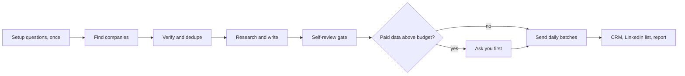

# outreach-conductor

<p align="center">
  
</p>

<p align="center">
  <b>A full week of researched outbound, written in your voice</b>
</p>

<p align="center">
  
  
  
</p>

A Claude Code skill that runs a weekly outbound cycle like a careful researcher would, just
faster. It finds companies that match your ideal customer profile, verifies each company and
the right person, researches them, removes anyone you already contacted or met, writes
personalized emails in your own voice, checks every one of them, sends them from your own
mailbox in small daily batches, picks a short list of people to connect with on LinkedIn,
logs everything to your CRM, and learns from last week's reply rates.

It asks its setup questions once. After that it runs the whole week by itself and reports
what it did. The only thing it asks about is money: paid data above your budget, or any
purchase. If you would rather approve each batch, set `autonomy.mode: review`. If you have not
connected a mail sender, it creates drafts and you send.

## Why it exists

Most outbound automation optimizes for volume and gets ignored. This skill is built around
the opposite: a verification ladder, a per-person research bar, a dedupe gate across every
place you might have talked to someone, drafting rules copied from emails you actually sent,
a no-repeat check, and a review loop. Volume is a config setting (default 100 a week).
Quality is not.

## Requirements

- [Claude Code](https://claude.com/claude-code) with web search.
- Python 3.9 or newer (standard library only; PyYAML is used if installed).
- Optional: an email connector that can send from your mailbox (or just create drafts), a
  company database or enrichment tool, a search API, a CRM with a CLI or API. None are
  required. A CSV file works as the CRM.

## Install

```bash
git clone https://github.com/mariagorskikh/outreach-conductor ~/.claude/skills/outreach-conductor
```

## Configure

Either let the skill interview you on first run ("run weekly outreach" with no config starts
the interview), or do it by hand:

```bash
cd ~/.claude/skills/outreach-conductor
cp config.example.yaml config.yaml
mkdir -p data voice
cp examples/sent-examples.example.md voice/sent-examples.md   # then paste your real emails
```

Then edit `config.yaml`: your name and voice notes, your offer, your ICP and fit rubric,
buckets and angles with their shares, the weekly volume, your CRM, the sender
(`email.send_via`, `email.daily_send_cap`), the `compliance.footer`, the LinkedIn cap, the
spending budget, and `autonomy.mode`. Keep API keys in environment variables, never in the
config.

Check it parses:

```bash
python3 scripts/week.py init
```

Environment variables:

| Variable | What it does |
|---|---|
| `OUTREACH_CONDUCTOR_CONFIG` | path to a config file outside the skill folder |
| `OUTREACH_STATE_DIR` | where week folders live (default `state/` next to the config) |

## Example prompts

- "Run this week's outreach."
- "Set up outreach-conductor for my company." (starts the interview)
- "Find and draft 50 prospects in the events and warm buckets only."
- "Resume the outreach run." (picks up from the state folder)
- "Who should I connect with on LinkedIn this week?"
- "Switch outreach-conductor to review mode." (approve each batch yourself)
- "What got replies last month? Update next week's plan."

## How it works



1. **Setup, once.** On the first run it asks a short batch of questions (your offer, ICP,
   voice, sender, caps, budget) and writes `config.yaml`. Weekly runs ask nothing.
2. **Kickoff.** Reads the config and your example emails, snapshots the CRM, logs last
   week's sends, replies and bounces, and reads the reply rates.
3. **Find.** Parallel scout agents search per bucket and angle (look-alikes of your best
   customers first, then fresh signals like funding and launches) and write candidates to
   files as they go.
4. **Verify.** Each company must be real, funded or staffed, with a working site that sells
   into your ICP. The right person must have a real profile. Every candidate is checked
   against your CRM, sent mail, drafts, message threads, calendar and opt-out lists.
5. **Enrich.** Finds addresses on a ladder from proven to guessed, and keeps at least 80% on
   a verified rung. Paid credits stay inside your weekly budget; anything above it waits for
   your yes.
6. **Write and self-review.** Writers research each person and write in your voice. A
   no-repeat check, a lint, and a fresh reviewer per slice of 50 catch copy-paste, false
   hooks and AI tells. Every fact and link is checked before anything goes out.
7. **Send.** Each business day it sends a batch under your daily cap from your own mailbox,
   spread through business hours, with your footer, skipping opt-outs and unverified
   addresses. Real sends are logged to your CRM as touches. No sender configured: drafts.
8. **LinkedIn.** A ranked list of people to connect with. If you run an invite tool, it gets
   the list inside your caps; otherwise you send by hand.
9. **Report and learn.** One summary of everything that went out, what was skipped and why.
   `reply_rates.py` measures reply and meeting rates by opener, subject, length, bucket and
   angle, and next week's briefs change accordingly.

Everything for a week lives in `state/<YYYY-Www>/`, so a run can stop and resume across
sessions without redoing work, and never sends the same email twice.

| It does by itself | It asks you first | It always stops on |
|---|---|---|
| research, writing, review, sending inside the daily cap, CRM updates, the LinkedIn list, small quota shifts from reply data | paid data above `spending.weekly_budget`, buying a list, tool, domain or mailbox, upgrading a plan | bounces above `email.bounce_stop`, platform or mail provider warnings, login or captcha prompts, opt-outs, a fact it cannot verify |

## What's in the box

```
SKILL.md                    the conductor: rules, phases, resume
config.example.yaml         every company-specific setting
references/
  setup.md                  first-run interview
  quotas.md                 buckets, angles, funnel, backfill, report template
  sources.md                where candidates come from (tool agnostic)
  verification.md           legit bar, research bar, dedupe and already-met gates
  enrichment.md             address ladder, verified share, bounces
  drafting.md               shapes, no-repeat check, lint, review loop
  sending.md                daily batches, pacing, footer, bounce stop, logging
  linkedin.md               ranking, weekly cap, safety stops
  agents.md                 parallel subagents without losing work
  learning.md               reply-rate loop
  compliance.md             CAN-SPAM, GDPR basics, opt-outs, platform terms
scripts/
  week.py                   state folder: init, merge, gate, status, batch, uniq, ids,
                            send-queue, sent, export-drafts, top, carry, crm
  reply_rates.py            reply and meeting rates from a CSV export of sends
  oc_config.py              config loader (PyYAML optional)
examples/                   CRM, sends, opt-out and ledger CSVs, a sent-examples template
```

## Safety and compliance

You are responsible for your outreach, and in autonomous mode the skill sends in your name.
Read `references/compliance.md` before turning on `email.send_via`. In short: honest subjects
and sender, a physical address and opt-out in commercial email (`compliance.footer`), honor
every opt-out permanently, keep bounces low, and warm up a new mailbox slowly. Sending pauses
by itself when bounces pass `email.bounce_stop`. The skill never drives LinkedIn itself; it
ranks people, and invites go out by hand or through a tool you chose and are responsible
under LinkedIn's terms. Cold email at volume can get a domain flagged; start with a low daily
cap.

## Built by Maritime

This skill is open-sourced by [Maritime](https://maritime.sh) (YC F26), the cloud platform that gives every AI agent its own computer: sandboxes, agent boxes that keep their disk, and Linux desktops, Windows desktops and Android phones your agent can see and click. We run this skill ourselves.

Want it to run every week without your laptop open? Install Claude Code and this skill on a Maritime [agent box](https://maritime.sh/docs/persistent-sandboxes). It keeps the state folder between runs, so a long run picks up where it left off.

## More open-source skills from Maritime

- [talking-head-reel](https://github.com/mariagorskikh/talking-head-reel): turn a messy phone recording into an edited vertical reel
- [product-changelog](https://github.com/mariagorskikh/product-changelog): changelog email, social posts and video from what you shipped
- [linkedin-inbox-triage](https://github.com/mariagorskikh/linkedin-inbox-triage): find the real people in your LinkedIn inbox and answer them
- [slack-connect-onboarding](https://github.com/mariagorskikh/slack-connect-onboarding): shared Slack channels with customers, with a real welcome
- [ad-ops](https://github.com/mariagorskikh/ad-ops): run Google, Meta, X and Reddit ad accounts with a change ledger

## License

MIT. See `LICENSE`.
